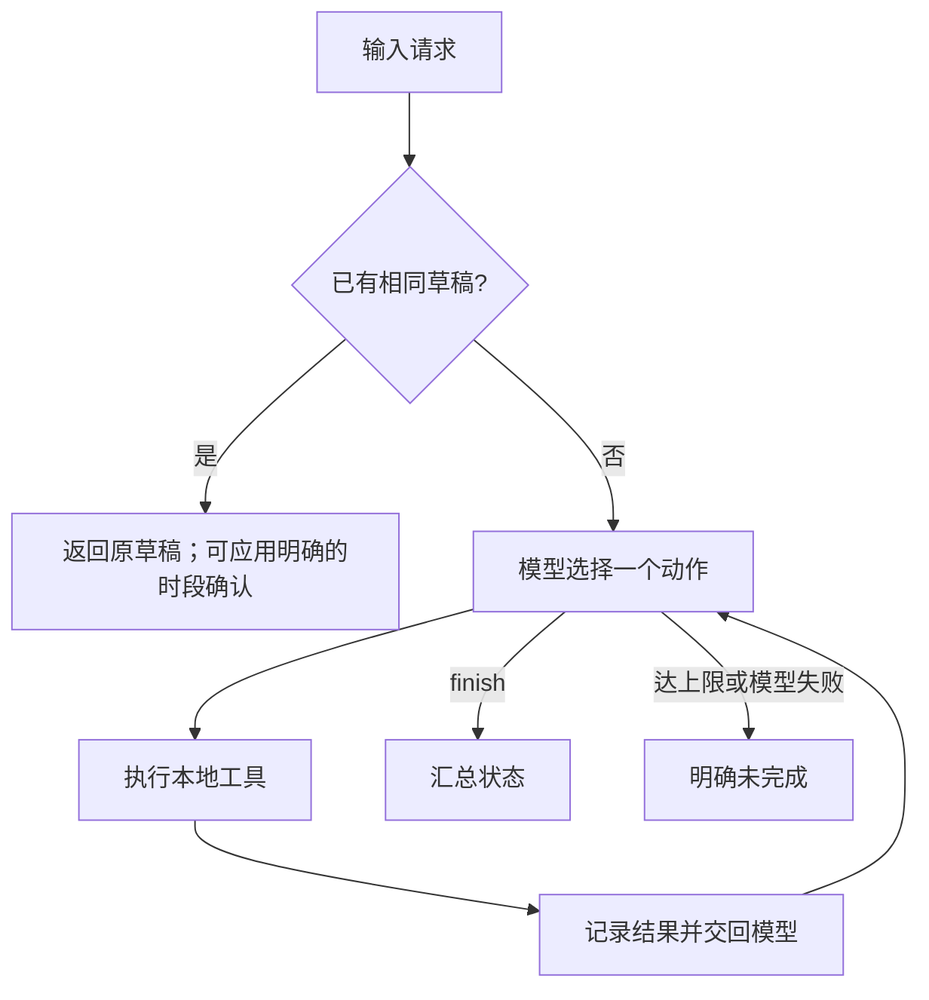

# 02 方案与动态决策

## 调用流程

OpenAI 模式经 Responses API 调用模型，`previous_response_id` 与 `function_call_output` 把工具观察结果交回模型。[OpenAI 接口依据](https://developers.openai.com/api/docs/guides/function-calling)。DeepSeek 模式经 Chat Completions API 调用模型，assistant 的工具请求和 tool 的结果保留在消息历史中，并关闭 thinking 以使用 `tool_choice=required`。[DeepSeek 接口依据](https://api-docs.deepseek.com/api/create-chat-completion/)。两种模式每轮提供五个函数工具，请求模型只选一个。DeepSeek 偶尔同轮返回多个只读调用，客户端逐个执行并汇总结果后再请求模型；同轮若包含写入或结束动作，则全部拒绝并要求重选。`model_turn` 表示同一次模型响应，避免把批量只读调用误记为逐轮调整。模型可因缺字段或规则风险结束；时段冲突时查询替代时段；保存失败时观察错误再决定下一步。Trace 记录动作、参数、返回值和模型提供的一句事实依据，不记录内部思维过程。

离线 `MockPolicy` 根据最新工具观察选择下一动作，可复现不同路径；它是测试替身，**不证明模型决策能力**。两个模式共用业务工具和安全边界。

## 写入边界

- 保存前必须观察到素材存在、规则通过、目标时段空闲。代码会再次核验，不能只相信模型文字。
- SQLite 唯一请求键防重复；写入事务内再次查占用，降低并发重叠风险。
- 硬性时段变更只保存 `pending_confirmation` 草稿；提供完全匹配的用户确认后改为 `confirmed_time`，仍不发布。
- 最多 10 个决策步骤、8 次工具调用，可通过 CLI 参数缩小；超限为 `incomplete`。
- 只有 `save_draft` 工具能写数据库；项目无发布 API。

## 技术取舍

选择 Python 标准库和 SQLite，减少安装步骤，便于评审复现。模型接入用 HTTP 直接调用供应商 API，不引入 Agent 框架；本项目的核心是清晰的决策循环和可验证边界。合成规则检查由确定性工具完成，模型负责何时检查、冲突后选哪一候选时段、何时停止。时间候选来自固定排期文件，不生成任意时间。
